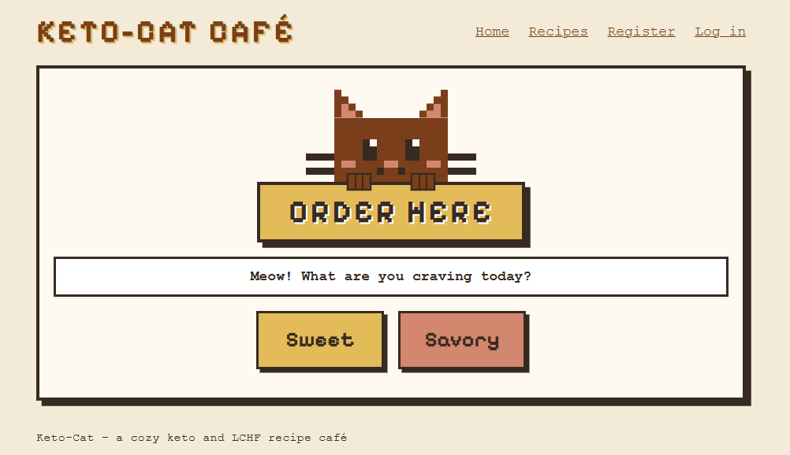
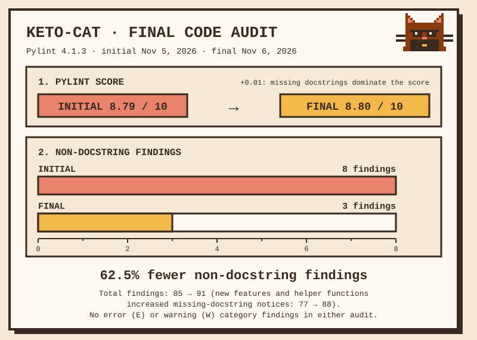
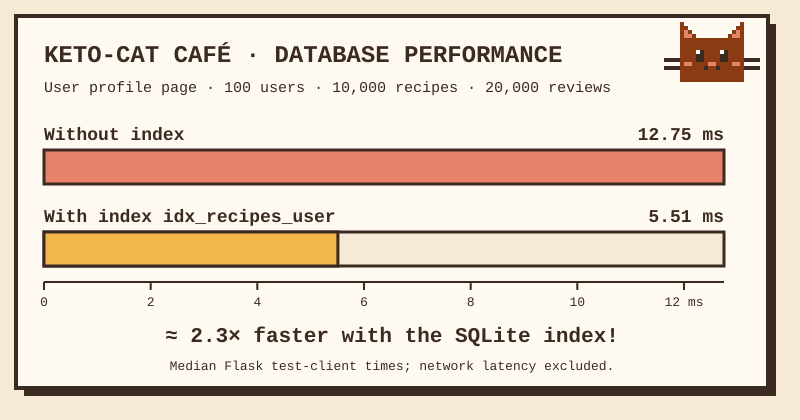

# Keto-cat



Sovelluksessa käyttäjät pystyvät jakamaan keto- ja LCHF-reseptejään. Reseptissä lukee tarvittavat ainekset ja valmistusohje. Sovelluksen kissa auttaa valitsemaan, mitä tehdä: käyttäjä kertoo, tekeekö mieli suolaista vai makeaa, ja kissa ehdottaa sopivaa reseptiä.

Sovelluksen käyttöliittymä on englanninkielinen. Käyttäjät voivat kuitenkin kirjoittaa reseptinsä millä kielellä tahansa.

Tässä pääasiallinen tietokohde on resepti ja toissijainen tietokohde on kommentti reseptiin.

## Toteutetut ominaisuudet

- Käyttäjä pystyy luomaan tunnuksen, kirjautumaan sisään ja kirjautumaan ulos.
- Käyttäjä pystyy lisäämään keto- ja LCHF-reseptejä sekä muokkaamaan ja poistamaan omia reseptejään.
- Kaikki käyttäjät, myös kirjautumattomat, näkevät eri käyttäjien lisäämät reseptit.
- Käyttäjä pystyy etsimään reseptejä hakusanalla. Haku kohdistuu reseptin nimeen ja aineksiin.
- Reseptilistan voi suodattaa maun perusteella, ja suodatusta voi käyttää yhdessä haun kanssa.
- Etusivun pikselitaidekissa ehdottaa satunnaisen reseptin käyttäjän valitseman maun perusteella.
- Reseptilista on sivutettu: sivulla näytetään 10 reseptiä. Sivutus toimii myös haun ja maun suodatuksen kanssa.

### Reseptien luokittelut

Käyttäjä luokittelee reseptin sitä lisätessään tai muokatessaan. Luokittelujen vaihtoehdot on tallennettu tietokantaan.

- Maku (Taste): Sweet tai Savory. Pakollinen, yksi vaihtoehto.
- Ruokavalio (Diet): Keto tai LCHF. Vapaaehtoinen, yksi vaihtoehto.
- Ateria (Meal): Breakfast, Main course, Snack tai Dessert. Vapaaehtoinen, yksi vaihtoehto.
- Erityisruokavalio (Restrictions): Dairy-free, Egg-free ja Nut-free. Vapaaehtoinen, vaihtoehtoja voi valita useita.

Vapaaehtoisia luokitteluja voi muuttaa tai poistaa reseptiä muokattaessa. Maku on aina valittava. Reseptin sivulla näytetään kaikki sen luokittelut.

### Käyttäjäsivut

- Jokaisella käyttäjällä on julkinen käyttäjäsivu, joka näyttää käyttäjän julkaisemien reseptien määrän, listan niistä ja käyttäjän kirjoittamien kommenttien määrän.
- Reseptin tekijän ja kommentin kirjoittajan nimestä pääsee hänen käyttäjäsivulleen.

### Kommentit ja arvosanat

- Kirjautunut käyttäjä voi kirjoittaa toisen käyttäjän reseptiin arvion, jossa on kommentti ja pakollinen arvosana 1–5.
- Käyttäjä voi antaa samalle reseptille vain yhden arvion, eikä hän voi arvioida omaa reseptiään.
- Käyttäjä voi muokata ja poistaa omia arvioitaan.
- Kaikki, myös kirjautumattomat käyttäjät, näkevät arviot. Reseptin sivulla näytetään arvosanojen keskiarvo ja määrä.
- Kun resepti poistetaan, myös sen arviot poistetaan.

## Suunnitellut ominaisuudet

Nämä ominaisuudet eivät ole vielä valmiita:

- Reseptilistan suodatus ruokavalion, aterian ja erityisruokavalion perusteella.
- Reseptikuvat.

## Sovelluksen käynnistäminen

Sovellus käyttää Pythonia (yhteensopiva Python 3.12:n kanssa), Flaskia ja SQLiteä. Muita kirjastoja ei tarvita.

Komennot ajetaan projektin juurihakemistossa. Windowsissa komennot on tarkoitettu PowerShelliin. Linuxissa ja macOS:ssä käytetään yleensä komentoa `python3` komennon `python` sijaan.

1. Kloonaa repositorio ja siirry sen hakemistoon:

   ```
   git clone https://github.com/inga-divra/keto-cat.git
   cd keto-cat
   ```

2. Luo virtuaaliympäristö ja aktivoi se.

   Windows (PowerShell):

   ```
   python -m venv .venv
   .\.venv\Scripts\Activate.ps1
   ```

   Jos PowerShell estää aktivointiskriptin, salli se nykyisessä ikkunassa komennolla `Set-ExecutionPolicy -Scope Process -ExecutionPolicy Bypass` ja aja aktivointi uudelleen.

   Linux ja macOS:

   ```
   python3 -m venv .venv
   source .venv/bin/activate
   ```

3. Asenna Flask:

   ```
   pip install flask
   ```

4. Luo asetustiedosto `config.py` mallitiedoston `config.example.py` pohjalta.

   Windows (PowerShell):

   ```
   Copy-Item config.example.py config.py
   ```

   Linux ja macOS:

   ```
   cp config.example.py config.py
   ```

5. Luo satunnainen salainen avain:

   ```
   python -c "import secrets; print(secrets.token_hex(16))"
   ```

   Avaa `config.py` tekstieditorissa ja korvaa arvo `change-this-secret-key` tulostetulla avaimella. Tiedostoa `config.py` ei lisätä versionhallintaan.

6. Luo tietokanta `database.db`:

   ```
   python init_db.py
   ```

   Skripti luo tietokannan tiedostojen `schema.sql` (taulut) ja `init.sql` (kaikkien neljän luokitteluryhmän vaihtoehdot: Taste, Diet, Meal ja Restrictions) perusteella. Jos `database.db` on jo olemassa, skripti kysyy ennen sen poistamista. Vastaa `yes` vain, jos haluat aloittaa tyhjästä tietokannasta.

7. Käynnistä sovellus:

   ```
   flask run
   ```

8. Avaa selaimessa osoite http://127.0.0.1:5000.

Kun palaat myöhemmin projektin pariin, riittää aktivoida virtuaaliympäristö ja ajaa `flask run`.

## Sovelluksen testaaminen

Juuri luodussa tietokannassa ei ole käyttäjiä eikä reseptejä. Siksi testaus aloitetaan luomalla tunnukset ja lisäämällä reseptit.

1. Luo kaksi tunnusta sivulla **Register**, esimerkiksi `alice` ja `bob`. Käyttäjätunnuksessa on 3–20 merkkiä (kirjaimet, numerot, `-` ja `_`), ja salasanassa on vähintään 8 merkkiä.
2. Kirjaudu sisään ensimmäisellä tunnuksella sivulla **Log in**.
3. Lisää sivulla **Add recipe** kaksi reseptiä:
   - Ensimmäiselle maku **Sweet**, ruokavalio (**Diet**), ateria (**Meal**) ja useampi erityisruokavalio (**Restrictions**), esimerkiksi **Dairy-free** ja **Nut-free**.
   - Toiselle vain maku **Savory**. Jätä ruokavalioksi ja ateriaksi **Not specified** ja erityisruokavaliot valitsematta.

   Voit kirjoittaa aineksiin ja ohjeeseen useita rivejä, ja rivinvaihdot näkyvät reseptin sivulla. Reseptin sivulla näkyvät kaikki valitut luokittelut. Omassa reseptissä ei ole arviolomaketta, koska omaa reseptiä ei voi arvioida.
4. Avaa sivu **Recipes**. Siinä näkyvät kaikkien käyttäjien reseptit, niiden maku, lisääjä ja lisäyspäivä.
5. Kirjoita hakukenttään sana, joka esiintyy reseptin nimessä tai aineksissa, ja paina **Search**. **Clear** tyhjentää haun.
6. Suodata reseptejä painikkeilla **Sweet**, **Savory** ja **All recipes**. Suodatus toimii myös yhdessä haun kanssa.
7. Palaa etusivulle (**Home**) ja valitse **Sweet** tai **Savory**. Kissa ehdottaa satunnaista reseptiä, ja **Show me another** pyytää uuden ehdotuksen.
8. Avaa ensimmäinen resepti ja valitse **Edit**. Aiemmat luokittelut ovat valmiiksi valittuina. Vaihda ateria, poista ruokavalio valitsemalla **Not specified** ja poista yksi erityisruokavalio. Tallenna ja tarkista muutokset reseptin sivulta.
9. Avaa toinen resepti ja valitse **Delete**. Poisto pyytää vielä vahvistuksen.
10. Kirjaudu ulos, kirjaudu sisään toisella tunnuksella ja avaa ensimmäisen käyttäjän resepti. Muokkaus- ja poistolinkkejä ei näytetä. Jos kirjoitat osoiteriville suoraan `/edit_recipe/<id>` tai `/delete_recipe/<id>` toisen käyttäjän reseptin tunnisteella, sovellus palauttaa virheen 403 (Forbidden).
11. Kirjoita samaan reseptiin arvio kohdassa **Leave a review**: valitse arvosana 1–5, kirjoita kommentti ja paina **Send review**. Arvio näkyy reseptin sivulla, ja sivulla näkyvät arvosanojen keskiarvo ja määrä. Lomake katoaa, koska samaan reseptiin voi antaa vain yhden arvion.
12. Muokkaa arviota linkistä **Edit review** ja vaihda arvosana. Keskiarvo päivittyy. Kokeile myös **Delete review**: poisto pyytää vahvistuksen, ja sen jälkeen voit kirjoittaa arvion uudelleen. Jätä lopuksi yksi arvio reseptiin. Avaa sen **Edit review** -linkki ja kirjoita muistiin osoiterivillä näkyvä osoite, esimerkiksi `/edit_comment/1`.
13. Paina arvion kirjoittajan nimeä. Käyttäjäsivulla näkyvät kohdat **Published recipes** ja **Comments written**. Avaa myös ensimmäisen käyttäjän sivu reseptin tekijän nimestä ja tarkista, että reseptien määrä ja lista ovat oikein.
14. Kirjaudu ulos ja kirjaudu sisään ensimmäisellä tunnuksella. Toisen käyttäjän arviossa ei ole muokkaus- ja poistolinkkejä. Jos kirjoitat osoiteriville suoraan kohdassa 12 muistiin kirjoitetun osoitteen `/edit_comment/<id>` tai `/delete_comment/<id>`, sovellus palauttaa virheen 403 (Forbidden).
15. Kirjaudu ulos painikkeella **Log out** ja avaa resepti kirjautumattomana. Arviot, keskiarvo ja käyttäjäsivut näkyvät, ja arviolomakkeen tilalla on linkki **Log in**.

### Koodin laadun tarkastus



Koodi tarkastettiin alustavasti Pylintillä (versio 4.1.3) 5.11.2026. Pistemäärä oli 8,79/10 ennen korjauksia ja 8,80/10 niiden jälkeen. Muut kuin docstring-ilmoitukset vähenivät 8:sta 3:een (62,5 % vähemmän): toistuva SQL-koodi ja väärin sijoitetut importit korjattiin, ja pitkät funktiot jaettiin pienempiin. Ilmoitusten kokonaismäärä kasvoi 85:stä 86:een, koska uudet apufunktiot lisäsivät docstring-ilmoituksia (77 → 83). Kummassakaan ajossa ei ollut virhe- (E) eikä varoitusluokan (W) ilmoituksia.

Tarkastuksen tiedot ja jäljelle jääneiden ilmoitusten perustelut ovat raportissa [docs/pylint-initial-audit.md](docs/pylint-initial-audit.md). Tämä on alustava tarkastus: lopullinen raportti `pylint-report.md` tehdään sovelluksen lopullisesta versiosta.

## Suorituskyvyn testaus

### Testitietokanta

Suurta tietomäärää varten skripti `seed.py` luo erillisen testitietokannan tiedostojen `schema.sql` ja `init.sql` perusteella:

```
python seed.py --database test-data/large.db
```

Oletuksena tietokantaan tulee 100 käyttäjää, 10 000 reseptiä, 31 743 reseptin luokittelua ja 20 000 arviota. Satunnaisluvut tulevat kiinteästä siemenestä (`--seed 2026`), joten sama komento tuottaa aina samat tiedot. Määriä voi muuttaa valitsimilla `--users`, `--recipes` ja `--reviews`. Kaikkien testikäyttäjien (`user0001`–`user0100`) salasana on `seedpassword`.

Skripti ei koskaan käytä tiedostoa `database.db`. Se ei myöskään korvaa olemassa olevaa testitietokantaa ilman valitsinta `--overwrite`. Testitietokantoja ei lisätä versionhallintaan.

Suurella tietokannalla tarkistettiin, että sivutus (1 000 sivua), haku, maun suodatus, käyttäjäsivut, arviot ja kirjautuminen toimivat ja että `PRAGMA integrity_check` ja `PRAGMA foreign_key_check` eivät löydä virheitä.

### Indeksin vaikutus

Testattu sivu on käyttäjäsivu `/user/<id>`. Sivu laskee käyttäjän reseptit (`users.get_recipe_count`) ja listaa ne (`users.get_recipes`). Ilman indeksiä SQLite käy molemmissa kyselyissä läpi koko `recipes`-taulun (`SCAN recipes`). Indeksin kanssa se hakee vain kyseisen käyttäjän reseptit (`SEARCH recipes USING INDEX idx_recipes_user (user_id=?)`).

Lisätty indeksi (`schema.sql`):

```
CREATE INDEX IF NOT EXISTS idx_recipes_user ON recipes (user_id);
```

Mittaustapa:

- Tietokannasta tehtiin samanlaiset kopiot, joista vain yhdessä oli indeksi `idx_recipes_user`. Samoilla kierroksilla mitattiin myös kaksi muuta kokeiltua indeksiä (alla).
- Jokaisella kierroksella haettiin kaikkien 100 käyttäjän sivut vuorotellen kummastakin kopiosta. Kaksi ensimmäistä kierrosta olivat lämmittelyä, ja niiden jälkeen mitattiin 15 kierrosta eli 1 500 sivunlatausta kummastakin kopiosta.
- Aika mitattiin funktiolla `time.perf_counter()`, ja taulukossa on mittausten mediaani.
- Sivun aika mitattiin Flaskin testiasiakkaalla. Se sisältää Flaskin käsittelyn, tietokantakyselyt ja HTML-sivun muodostamisen, mutta ei verkkoliikennettä.
- Lisäksi mitattiin pelkät SQL-kyselyt samalla tavalla avoimen tietokantayhteyden kautta.
- Ympäristö: Windows 11, Python 3.13.7, SQLite 3.50.4.

| Mitattu | Ilman indeksiä | Indeksin kanssa | Nopeutus |
|---|---|---|---|
| Sivu `/user/<id>` | 12,75 ms | 5,51 ms | 2,3-kertainen |
| Kysely `users.get_recipe_count` | 2,754 ms | 0,065 ms | 42-kertainen |
| Kysely `users.get_recipes` | 3,526 ms | 0,546 ms | 6,5-kertainen |



Kaavio näyttää taulukon alkuperäiset mittaustulokset koko käyttäjäsivulle. Toistetuissa mittauksissa absoluuttiset ajat voivat olla erilaiset (katso alla).

Mittaus toistettiin kahdesti, ja tulokset olivat lähes samat (sivu ensimmäisellä kerralla 12,96 ms ja 5,54 ms).

Mittauksen voi toistaa skriptillä `benchmark.py`. Skripti kopioi annetun testitietokannan kahdeksi väliaikaiseksi kopioksi, joista toisessa ei ole indeksiä ja toisessa on, eikä muuta alkuperäistä tiedostoa. Se tulostaa tietokannan rivimäärät, kyselysuunnitelmat (`EXPLAIN QUERY PLAN`) ja mediaaniajat:

```
python seed.py --database test-data/large.db
python benchmark.py --database test-data/large.db
```

Absoluuttiset ajat riippuvat koneesta ja sen tilasta, mutta suhde pysyy samana. Kun `benchmark.py` ajettiin samalla koneella akkuvirralla, sivun mediaani oli 18,6–21,6 ms ilman indeksiä ja 8,6–10,2 ms indeksin kanssa (2,1–2,2-kertainen nopeutus). Myös alkuperäinen mittausskripti antoi samaan aikaan vastaavasti hitaampia aikoja (18,8 ms ilman indeksiä).

Myös indeksiä `comments (user_id)` kokeiltiin. Se nopeutti käyttäjän kommenttien laskemista (0,711 ms → 0,069 ms), mutta koko käyttäjäsivu nopeutui vain noin 1,1-kertaisesti, joten sitä ei lisätty. Indeksi `recipe_classes (class_id)` ei muuttanut reseptilistan kyselysuunnitelmaa eikä nopeuttanut kissan satunnaista ehdotusta, joten sitäkään ei lisätty.

### Jäljelle jäävät hitaat kohdat

Mitattu suurella tietokannalla indeksin kanssa, sivunlatauksen mediaani 100 mittauksesta:

| Sivu | Aika |
|---|---|
| `/recipes` (sivu 1) | 12,57 ms |
| `/recipes?page=1000` (viimeinen sivu) | 22,28 ms |
| `/recipes?q=chocolate` | 10,26 ms |
| `/?taste=Sweet` (kissan ehdotus) | 7,78 ms |

- Haku `LIKE '%sana%'` ei voi käyttää tavallista indeksiä, joten SQLite käy läpi kaikki reseptit.
- Reseptien määrän laskeminen (`COUNT(*)`) käy läpi kaikki hakuehtoon sopivat reseptit jokaisella sivulla.
- Kaukaiset sivut ovat hitaampia, koska `OFFSET` ohittaa edelliset rivit yksitellen.
- Kissan ehdotus (`ORDER BY RANDOM()`) järjestää kaikki valitun maun reseptit.

## Nykyiset rajoitukset

- Sovellus on vielä kehitysvaiheessa.
- Reseptikuvia ei vielä voi lisätä.
- Reseptilistan voi suodattaa vain maun perusteella. Muut luokittelut näkyvät reseptin sivulla, mutta niillä ei voi vielä suodattaa.
